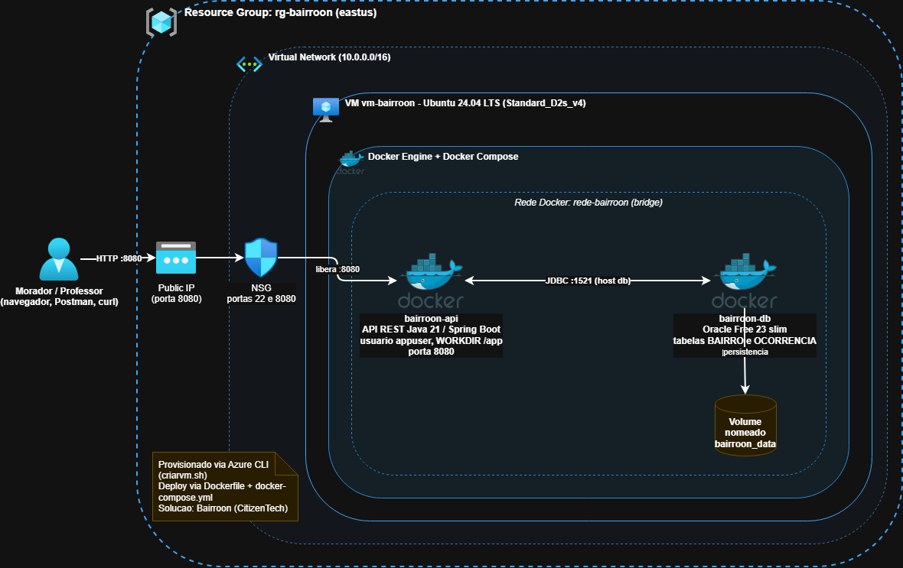

# Bairroon - Global Solution 2026/2 (CitizenTech) - DevOps Tools & Cloud Computing

## Integrantes
| Nome | RM | Turma |
|------|----|-------|
| Murillo Kenzo | RM566948 | 2TDSPA |
| Kauan Prado | RM566990 | 2TDSPA |
| Cauã Rocha | RM567593 | 2TDSPR |
| Gustavo Souza | RM567134 | 2TDSPR |

## Sobre a solucao
O Bairroon e um "Waze de bairro": moradores registram ocorrencias do dia a dia (alagamentos, buracos, iluminacao, acessibilidade, zeladoria) e acompanham o status de cada uma. Nesta entrega, a API REST (Java Spring Boot) e o banco Oracle rodam em containers Docker numa VM do Microsoft Azure.

ODS relacionado: 11 - Cidades e comunidades sustentaveis.

## Arquitetura
VM Ubuntu 24.04 no Azure (eastus), provisionada por Azure CLI. Dentro da VM, o Docker executa dois containers na rede `rede-bairroon`: `bairroon-api` (Spring Boot, porta 8080, usuario nao-root, WORKDIR /app) e `bairroon-db` (Oracle Free, porta 1521, volume nomeado `bairroon_data`). A API acessa o banco pelo nome do servico (`db`).

## Modelo de dados
Duas tabelas relacionadas: `BAIRRO` (1) ---- (N) `OCORRENCIA`, com chave estrangeira `OCORRENCIA.BAIRRO_ID`. Script: `init.sql`.

## Ferramentas e versoes
| Ferramenta | Versao |
|------------|--------|
| Ubuntu | 24.04 LTS |
| Docker | 29.1.3 |
| Docker Compose | 2.40.3 |
| Azure CLI | 2.91.0 |
| Java / Spring Boot | 21 / 3.3.5 |
| Oracle Free (container) | gvenzl/oracle-free:23-slim |

## How To (reproduzir do zero)
1. No Azure Cloud Shell (Bash), baixe o repositorio e crie a VM:

        https://github.com/murillokenzo/bairroon-devops.git
        cd REPO
        export VM_PASS='SuaSenhaForte@123'
        ./criarvm.sh

2. Conecte na VM (o IP aparece no final do script):

        ssh azureuser@IP_PUBLICO

3. Instale o Docker na VM e reconecte:

        sudo apt update && sudo apt install -y docker.io docker-compose-v2 && sudo usermod -aG docker $USER
        exit

4. Na VM, baixe o projeto e crie o `.env` a partir do `.env.example` (troque as senhas):

        https://github.com/murillokenzo/bairroon-devops.git
        cd REPO
        cp .env.example .env
        nano .env

5. Suba os containers em background e aguarde cerca de 2 minutos:

        docker compose up -d --build
        docker compose ps

6. Teste:

        curl http://localhost:8080/bairros
        curl http://localhost:8080/ocorrencias

   No navegador: `http://IP_PUBLICO:8080/ocorrencias`

## Endpoints
| Metodo | Rota | Acao |
|--------|------|------|
| GET | /bairros, /ocorrencias | Lista |
| GET | /bairros/{id}, /ocorrencias/{id} | Busca um |
| POST | /bairros, /ocorrencias | Cria (ocorrencia exige `"bairro":{"id":N}`) |
| PUT | /bairros/{id}, /ocorrencias/{id} | Atualiza |
| DELETE | /bairros/{id}, /ocorrencias/{id} | Remove (bairro com ocorrencias retorna 409) |

## Evidencias tecnicas (comandos)
Containers: `docker ps` | Logs: `docker compose logs --tail 20 api` | Acesso ao container: `docker exec -it bairroon-api sh` | Usuario: `docker exec bairroon-api whoami` | Diretorios: `docker exec bairroon-api ls -la /app` | Volume: `docker volume inspect bairroon_data` | Persistencia: `docker compose down` e `docker compose up -d` (sem `-v`) | SELECT direto no banco:

    set -a; source .env; set +a
    docker exec -i bairroon-db sqlplus -s "$DB_USER/$DB_PASS@//localhost:1521/FREEPDB1" <<'SQL'
    SELECT o.id, o.titulo, o.status, b.nome AS bairro FROM ocorrencia o JOIN bairro b ON b.id = o.bairro_id ORDER BY o.id;
    SQL

## Exclusao dos recursos
    az group delete --name rg-bairroon --yes --no-wait

## Uso de IA generativa
Ferramenta: Claude (Anthropic). Usada como apoio para explicar erros, revisar comandos do Azure CLI/Docker e estruturar o README. O grupo executou, testou e revisou todos os comandos e o codigo.
